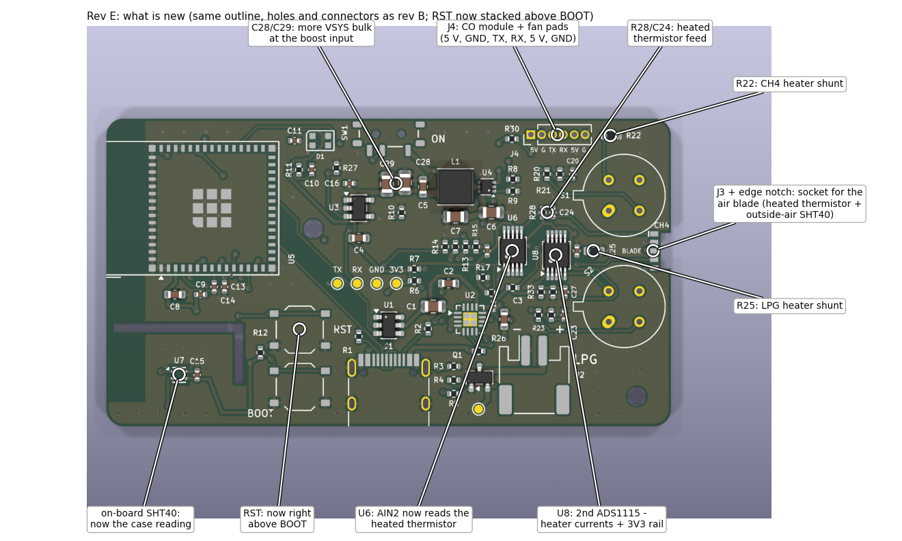
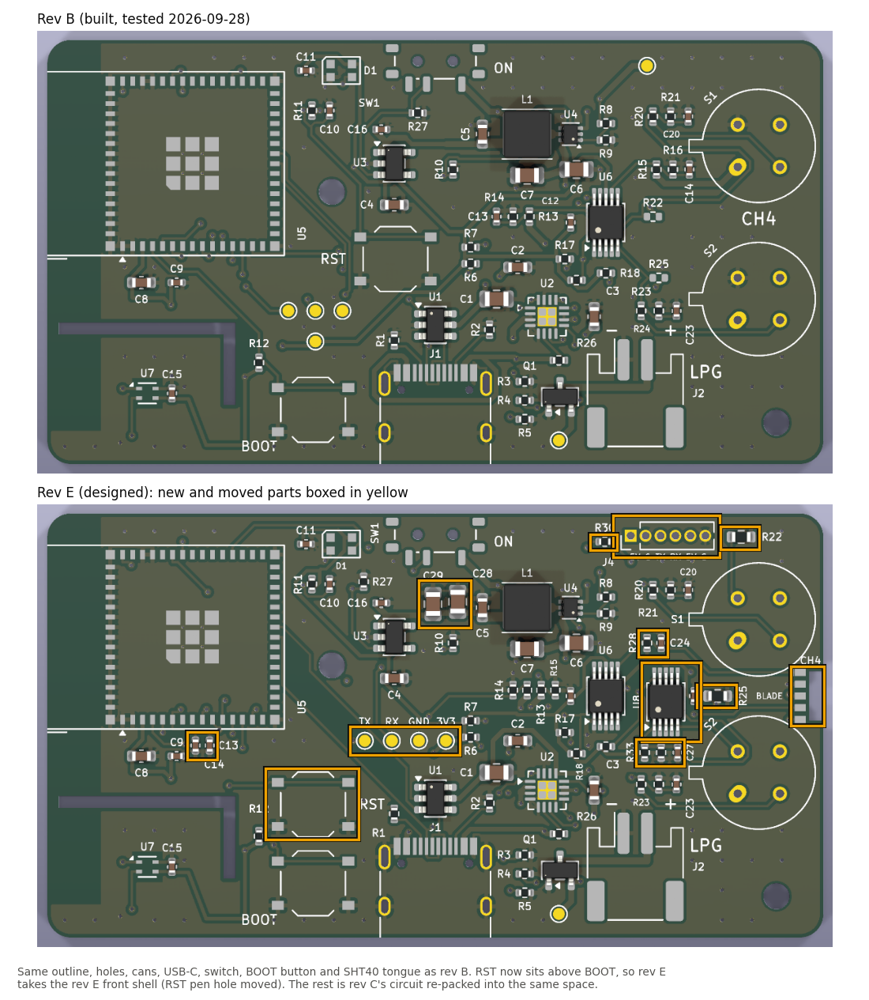
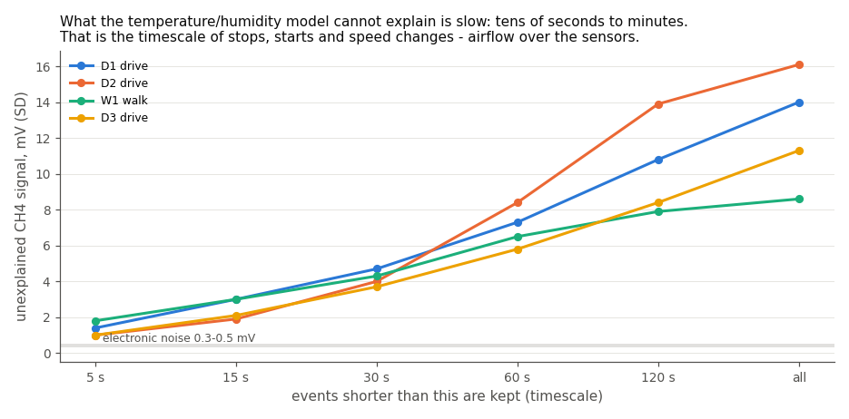
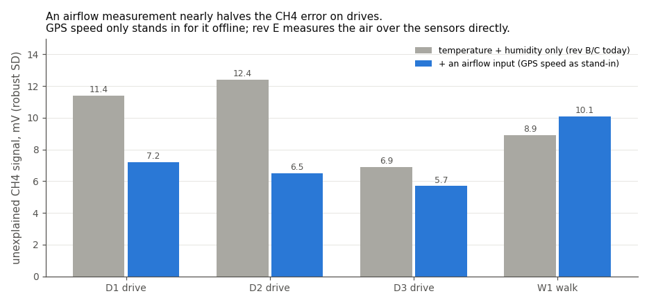
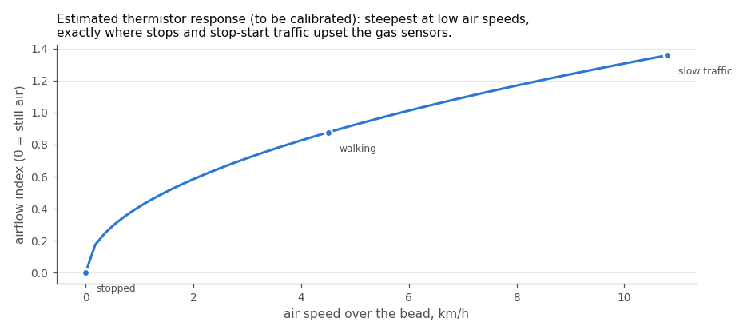
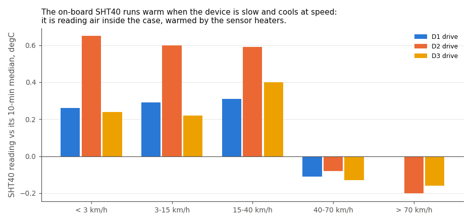
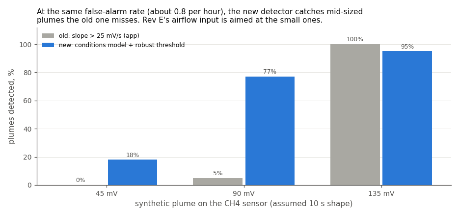
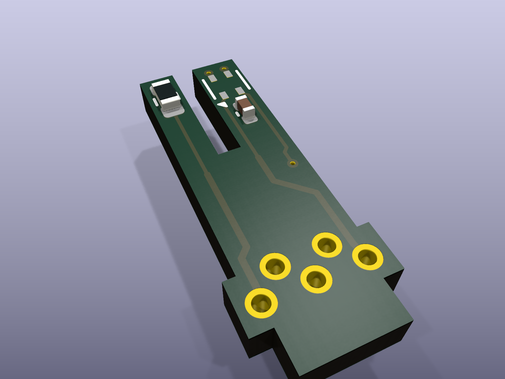

# The board: what it measures and why

The board is the current phone-companion board. It keeps everything that worked
on the first board and adds the things the first survey analysis said were
missing. JLCPCB has made it, and it passed a bench test on 2026-10-22. This note
explains, in plain terms, what it measures and why. The detail is
in the board's own [README](../hardware/board/README.md), the parts
list in [HARDWARE.md](HARDWARE.md), and the analysis in [REPORT.md](REPORT.md).

## The short version

- **It fits the printed case.** It uses the first board's 66 × 36 mm outline,
  with the same mounting holes, sensor positions, USB-C, switch, LED and BOOT
  button, so the printed enclosure (`case.scad`) takes it. RST sits right above
  BOOT, so use the current front shell, `hardware/enclosure/stl/front.stl`. It
  has RST's pen hole in the right place and a slot for the air blade between
  the sensor caps.
- **It measures airflow,** the biggest thing the gas detector cannot explain at
  the moment. A tiny plug-in board, the **air blade**, stands in a notch between
  the two gas sensors and pokes out through a slot in the case face, into the
  same air the gas sensors breathe. Its tip carries a heated thermistor (moving
  air cools it); the precise ADC reads it, not the ESP32's own. JLC makes and
  assembles the blade, so every unit is the same. **The current blade cannot be
  fitted, though,** and is being redesigned (see
  [What is not proven yet](#what-is-not-proven-yet)).
- **It can test whether the gas sensors measure their own airflow.** A tiny
  resistor in each sensor's heater circuit lets a second ADC read the heater
  current. If moving air cools the heater enough to change it, the board learns
  what each gas sensor actually feels. This is an experiment; it costs pennies.
- **It reads the outside air, not the inside of the case.** The board's own
  temperature/humidity sensor turns out to measure air inside the case, warmed
  by the gas sensors' heaters (see below). The air blade carries a second
  temperature/humidity sensor on its tip, out in the air; the on-board one
  becomes the case reading.
- **It is ready for a CO sensor and a sampling fan:** six solder pads with 5 V,
  ground and a serial line. CO is how exhaust can be told apart from a gas leak.
- **It starts more reliably on USB alone,** with extra capacitance where the
  first board browned out when the heaters switched on.

## Why: what the survey data showed

### 1. The detector's leftover error is slow, and that points at airflow

The detector predicts what each gas sensor should read from temperature and
humidity, and looks for readings well above that prediction. On the four
October surveys, temperature and humidity explain most of the signal (62–92 %).
What is left is not electronic noise (that is only 0.3–0.5 mV). It is slow
wandering over tens of seconds to minutes:

Over 5–15 seconds the leftover is only 1–3 mV. Over minutes it is 9–16 mV.
Things that change over minutes on a survey are stops, starts, traffic and
speed: **the airflow over the sensors.** Air moving past a gas sensor cools its
heater, and that changes its reading by tens of millivolts, about as much as a
small gas plume.

### 2. An airflow input would roughly halve that error on drives

The current boards cannot measure airflow, so the test used GPS speed as a
stand-in, offline only (speed is never an input to the detector itself). Adding
it cut the CH4 sensor's unexplained signal on drives from about 12 to about
7 mV:

GPS speed is a poor proxy: it says nothing about wind, a stop next to a lorry,
or how the device is held, and it did not help on foot. The board measures the
air over the sensors directly, so it should do at least as well, and possibly
better when walking.

### 3. A thermistor is most sensitive exactly where it is needed

A small heated bead loses heat faster the more air moves past it. Its response
is steepest at low speeds (estimated from the datasheet; it will be calibrated
by survey 1 in [PROTOCOL.md](PROTOCOL.md)):

Standing still, walking and stop-start traffic are where the gas sensors are
upset most, and where the bead tells those situations apart best.

### 4. The temperature sensor is reading the inside of the case

The board's SHT40 is cut free on a slotted tongue to keep it away from the
heaters' warmth, but it is still inside the case. On every drive it read warmer
when the car was slow and cooler at speed:

That is case air: about 0.6 W of sensor heaters warm it, and airflow through the
case cools it. During the indoor stop on 6 October it read 28-32 °C. So part of
what the model treats as "temperature" is really airflow, and the humidity it
uses is the case's, not the street's. The air blade's SHT40 sits out in
the air beside the sensor caps and supplies both; the on-board one is kept as the
case reading.

### 5. Where detection stands today, and what the board is aiming at

Against the same synthetic plumes, at the same false-alarm rate (about one an
hour), the new detector already beats the app's old slope detector on mid-sized
plumes:

Small plumes (around 45 mV) are still mostly missed, because the airflow error
is as big as they are. Taking that error out is what the board is for.

## What is new on the board

The air blade, 5.7 × 14.9 mm: the SHT40 on the left prong, the heated thermistor
on the right, five pads on the foot that solder to J3
([hardware/air_blade](../hardware/air_blade/)). This design cannot be fitted
yet (see [What is not proven yet](#what-is-not-proven-yet)):

| | Part | What it does |
|---|---|---|
| **J3** + a notch in the board's end | 5 solder pads between the gas sensors | the socket for the [air blade](../hardware/air_blade/): a heated thermistor and an outside-air SHT40 on a tiny plug-in board, out in the air at the inlet |
| R28, C24 | resistor and capacitor | feed the blade's heated thermistor 2.7 mW, about 1 °C above the air |
| **U6** (existing ADC) | input 3 | now reads the heated thermistor, with 16-bit precision |
| GPIO1 / GPIO2 | ESP32 pins | now read the battery and heater voltages, which do not need that precision |
| **R22, R25** | 0.5 Ω resistors in the heater circuits | let the heater current be measured (fit a 0 Ω link instead to turn this off) |
| **U8** | a second ADC | reads both heater currents, plus the 3.3 V supply so the thermistor readings can be corrected for it |
| **J4** | 6 solder pads on the top edge | CO module and fan: 5 V, ground, serial in, serial out, 5 V, ground |
| R30 | resistor | protects the CO module's serial input |
| C28, C29 | capacitors | steadier supply when the heaters switch on with only USB power |

What stays the same as on the first board: the gas sensors and their circuit, the on-board temperature
and humidity sensor on its isolated tongue (its temperature is now the case
reading), the processor, the battery charger, the heater supply, Bluetooth, and
the app protocol.

## Why a new board rather than add-ons for the first one

A thermistor and a CO sensor could be hand-wired to the first board, but the
new board does it properly:

| | first board with hand-fitted add-ons | this board |
|---|---|---|
| Thermistor ADC | ESP32's own, about 1 mV steps after averaging | ADS1115, 0.125 mV steps |
| Thermistor supply | assumed to be 3.30 V; a 1 % drift reads as about 0.4 °C | measured every sample |
| Wiring | bodge wires to unfitted-resistor pads and test points | pads in the right places |
| Thermistor location | wherever the wire reaches | on the air blade, through a slot in the case between the sensor caps, the same on every unit |
| Outside air temperature/humidity | case air only | the air blade's SHT40 |
| Heater-current experiment | not possible | built in |
| Battery and heater monitors | lost if the fallback pads are used for thermistors | kept, on the ESP32 |
| Fits the printed case | yes | yes, with the current front shell (RST hole moved) |

## What it costs

About the same as the first board to make. The board is the same size; the extras are a
second ADS1115 (about £2 at LCSC) and a handful of resistors and capacitors.
Add the air blade, about £3–4 each assembled (an SHT40 at about £1.90, a 1 kΩ
thermistor and a capacitor at pennies, and a tiny board ordered as a panel; a cheap
heated thermistor does as well as the £23 BR16 in the survey analysis), and £8–15
for a CO module if you want
one.

## What is not proven yet

- **The board has been made and passes a bench test, but has not been
  surveyed with yet.** New boards arrive with blank flash; the power switch
  (SW1) must be ON even on USB; the first flash needs the BOOT and RESET
  buttons and a full upload.
- **The current air blade cannot be fitted.** J3 sits in a 3.8 mm gap between
  the two 13 mm tall sensor cans, and its pads stop 0.3 mm short of the blade's
  notch, so there is no realistic way to solder the blade to them. The blade is
  being redesigned; until then the board has no airflow or outside-air
  readings.
- **How much airflow the thermistor reads, and whether it tracks the gas
  sensors' airflow effect,** is estimated from datasheets. Survey 1 in
  [PROTOCOL.md](PROTOCOL.md) measures it.
- **Whether heater current changes measurably with airflow** is unknown: Figaro
  does not publish how much the heater's resistance changes with temperature.
  That is exactly what the shunts are there to find out.
- **The detector's coefficients were fitted on the case-air readings.** With the
  air blade's outside-air readings they must be refitted from new surveys.
- **How much the blade's thermistor self-heats** (some of its heat goes into the
  blade rather than the air) and how strongly it follows airflow.
- **The detection gains above are from offline analysis of four surveys with
  one device.** The real gain will be known after the first surveys with the
  thermistor fitted.

## Building and ordering

- Board files: [hardware/board](../hardware/board/).
  Upload `production/gerbers.zip`, `bom.csv` and `cpl.csv` to JLCPCB (details
  in the board's README).
- Do not order the current [air blade](../hardware/air_blade/): it cannot be
  soldered to J3 and is being redesigned.
- Hand-solder the two Figaro sensors and, if used, the CO module and fan on J4.
- Firmware: `pio run -d firmware/phone_board -e board --target upload`.
- These plots are regenerated by `python hardware/board/gen/note_plots.py`.
