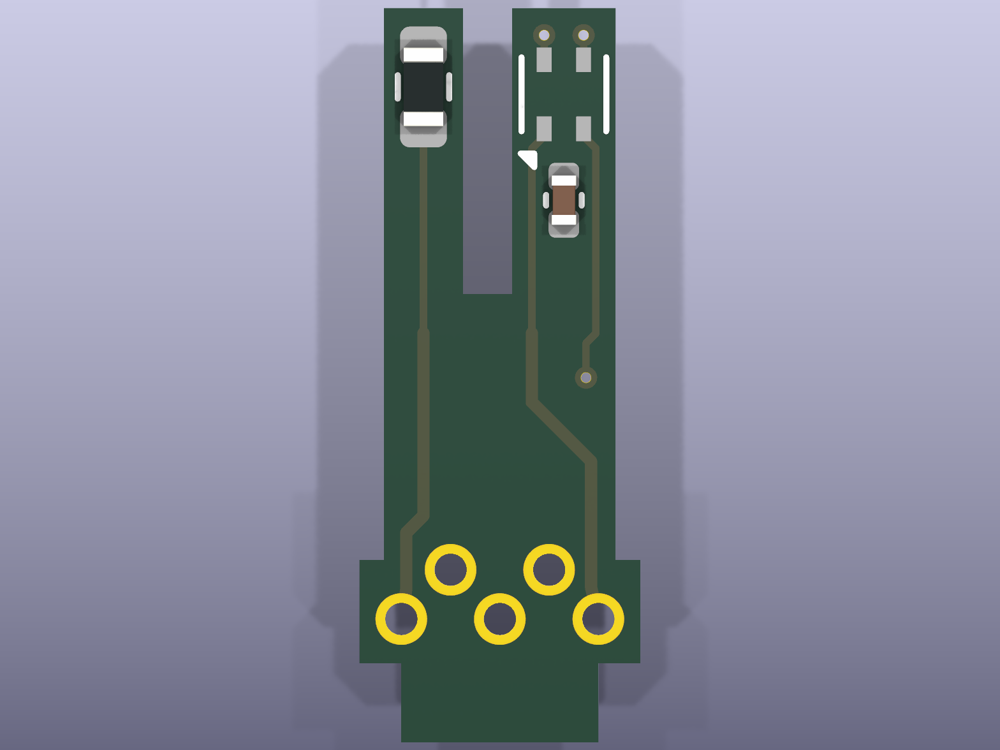
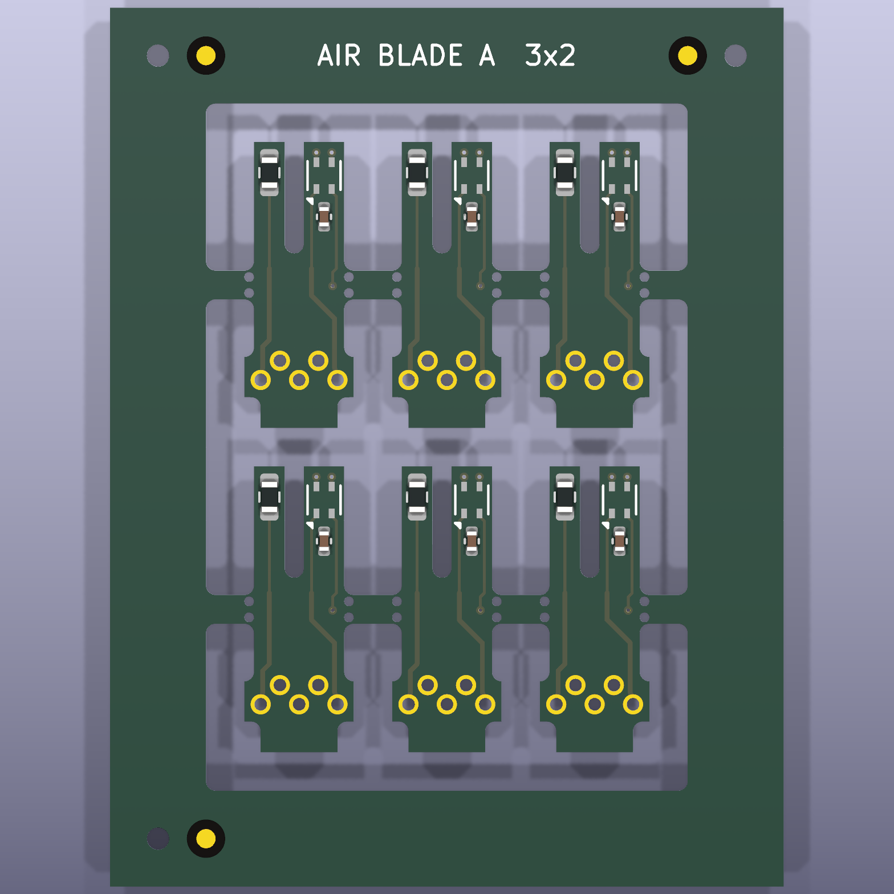

# Air blade

A tiny plug-in board for the [phone-companion board](../board/).
It stands upright in a notch in the board's sensor end, between the two gas sensor
cans, and pokes 4.5 mm out through a slot in the case face, so its tip sits in the
outside air level with the gas sensors' caps. It carries:

- **an outside-air temperature/humidity sensor** (SHT40-CD1B, I²C address 0x46;
  an SHT40-BD1B at 0x45 works too, but never an -AD1B, which clashes with the
  board's own). The board's own SHT40 (0x44) sits inside the case and reads the
  case air, warmed by the gas sensors' heaters; this one reads the street;
- **the heated airflow thermistor** (a 1 kΩ NTC). Moving air cools it; the
  firmware turns that into an airflow index for the gas detector
  ([docs/HARDWARE.md](../../docs/HARDWARE.md) section 1). The SHT40 beside it gives
  it the air temperature it needs.

## Status: being redesigned, do not order

**The design in this folder can't realistically be fitted, so don't order it.**
The board's blade pads (J3) sit in a 3.8 mm gap between the two sensor cans, which
stand 13 mm tall, and they stop 0.3 mm short of the notch the blade stands in. So
the blade never touches them, and every joint has to be made down in that narrow
gap, where a soldering iron can't realistically reach. The design itself passes
KiCad's checks; the problem is getting it onto the board.

A new design is being worked out. The options so far:

- **for boards already made:** solder short flying wires flat onto J3 first, while
  there is still room, and move the blade's joints higher up, where an iron can reach;
- **for future boards:** a proper slot through the board with pads on the
  underside, so the blade can be soldered from below.

**The first batch is unusable.** It was drawn mirror-image: its pads meet J3 in
reverse order, so its ground lands on the board's SCL and its SDA on the thermistor
feed. Soldered in, it holds the board's I²C bus at about 0.5–1 V and nothing on the
bus answers (seen on the bench 2026-10-22). Its flat foot pads also never touched
J3, so solder had to bridge the gap and bridged to the next pad instead. Never
solder one of those blades (flat pads, no holes) to J3. Their files are in
[archive/air_blade_first_batch](../../archive/air_blade_first_batch/).

The design here fixes the mirror error and the pads. It:

- is **the right way round**: seen from the parts side, the thermistor prong is on
  the left, over J3 pad 1 by the CH4 can, and the SHT40 on the right. That also puts
  each part over its own pocket in the case guide;
- has **five plated holes** instead of flat pads. A short leg of 0.5 mm wire goes
  through each one and bends down onto its J3 pad. A plated hole runs right through
  the board, so it cannot peel off like a flat pad;
- has the holes in **two staggered rows**, so neighbouring joints are 2 mm apart,
  not 1 mm;
- has **wider tracks** (0.25 mm) from below the prongs down to the foot;
- is drawn at **1.6 mm** thick, which is what the case is set up for;
- relies on the case guide and a bead of epoxy to hold it, not the solder.

The pin table, parts and shape below still hold for the redesign unless it says
otherwise.

## Shape

5.7 × 14.9 mm, 2 layers, **1.6 mm thick**.

- **Tip: two prongs, 1 mm apart.** The SHT40 and its capacitor are on one, the
  heated thermistor on the other, so the thermistor's warmth (2.7 mW) does not
  reach the SHT40. The gap runs down to just below the case face.
- **Foot:** five plated holes for wire legs, just above two small shoulders. The
  shoulders rest on the board's top surface; below them a tab drops into its notch.
- **No copper pours,** and thin (0.15 mm) tracks on the prongs: copper would carry
  the thermistor's heat away and blunt the airflow signal. Lower down, inside the
  case, the tracks are 0.25 mm.

| Foot hole | Net | Board's J3 pad |
|---|---|---|
| 1 | heated thermistor | 1 |
| 2 | GND | 2 |
| 3 | 3.3 V | 3 |
| 4 | SCL | 4 |
| 5 | SDA | 5 |

## Parts

All three are assembled by JLC (LCSC numbers in `production/bom.csv`):

| Ref | Part | LCSC | What it does |
|---|---|---|---|
| U1 | Sensirion SHT40-CD1B-R3 | C7461852 | outside-air temperature and humidity, I²C 0x46 |
| C1 | 100 nF 0402 | C1525 | U1's supply decoupling |
| RT1 | Murata NCP18XQ102J03RB, 1 kΩ NTC, 0603, B 3650 K | C152577 | heated airflow thermistor, fed 2.7 mW through the board's R28 (1 kΩ) |

## Ordering from JLCPCB (not until the redesign)

**Don't follow these steps yet.** The current design can't be fitted (see
[Status](#status-being-redesigned-do-not-order)). They are kept for when the
redesign is ready.

The blade is too small for JLC to assemble on its own, and JLC's own panel
option ("Panel by JLCPCB") only does V-cut, which can't follow the forked tip
or the shoulders. So order the ready-made panel in **`production/panel/`**: 6
blades in a 35 × 46 mm frame, with tooling holes and alignment marks for the
assembly machine.

1. **PCB:** upload `production/panel/gerbers.zip`. 2 layers, **1.6 mm** thick.
   Leave **Delivery Format at "Single PCB"**: the file already is the panel, so
   the quantity counts panels (minimum 5 = 30 blades of bare board). 0.15 mm
   track and clearance, 0.45 mm vias with a 0.2 mm drill. Two of the vias sit in
   C1's pads: choose JLC's filled and capped via-in-pad option, as for the board.
2. **Assembly:** top side only, `production/panel/bom.csv` and
   `production/panel/cpl.csv`. Assemble **2 panels** (JLC's minimum) = 12 blades.
   Look over JLC's placement preview, especially each U1's pin-1 corner
   (positions matched to LCSC's footprints by `gen/jlc_align.py`).
3. **Breaking out:** each blade hangs on two small tabs of drilled holes on its
   long sides, below the fork. Bend each blade out with pliers, then file the
   two nubs flush so the blade slides through the case slot. The tips, the
   slot and the foot have no tabs, so they need no filing.

`production/gerbers.zip`, `bom.csv` and `cpl.csv` (one blade) are kept for reference.

## Fitting it to the board (for the current design)

These steps were written for the current design. On a real board, step 5 can't
realistically be done (see [Status](#status-being-redesigned-do-not-order)); they
are kept until the redesign replaces them.

You need: five pieces of **0.5 mm (24 AWG) solid tinned copper wire**, about 6 mm
long (offcuts of resistor legs work if they slide into the holes), flux, a fine
soldering tip, and quick-set epoxy.

1. **Legs into the blade.** Push one wire through each of the five foot holes from
   the back (the side with the "AIR BLADE B" label) so about 3 mm sticks out of the
   front (the side with the parts). Solder each one on the front, then trim the back
   flush and touch it with the iron so it is smooth. The case has only about 1 mm of
   room behind the blade.
2. **Bend the legs down.** Bend each leg down towards the tab, at a slant, so its end
   will rest on its J3 pad about 0.8 mm in front of the blade. The top row (holes 2
   and 4) bends a little steeper than the bottom row (1, 3 and 5).
3. **Tin the board's J3 pads,** the five pads beside the notch between the cans, labelled
   BLADE.
4. **Stand the blade in the notch,** parts facing the middle of the board, with the
   shoulders flat on the board. Seen from the middle of the board, the thermistor prong
   is on the left, on the CH4 can's side. Each leg should land on its own J3 pad:
   hole 1 (bottom left) on pad 1, the one nearest the CH4 can. Trim any leg that reaches past its pad.
5. **Solder each leg to its pad.** Check that no two pads are joined, then check each
   of the five connections with a meter. Before fitting the case, power the board
   on USB: the serial log should say "Air blade SHT40 found at 0x46".
6. **Epoxy.** Run a small bead of epoxy along both shoulders where they sit on the
   board, and into the notch around the tab. Keep it off the prongs. This bead, not
   the solder, is what holds the blade upright. Let it set before you fit the case.
7. **Fit the board into the front shell**
   ([hardware/enclosure](../enclosure/), `stl/front.stl`) straight down,
   not tilted: the blade slides into a guide on the inside of the face and out
   through the slot between the sensor collars. The guide holds it over 5.8 mm, so
   knocks on the tip go into the case, not the joints.

**First-batch blades** (flat pads, no holes) are wired in reverse and must not be
soldered to J3: they stop the board's I²C bus working.

## Firmware

Nothing to set: the board's firmware (`pio run -d firmware/phone_board -e
board`) looks for an SHT40 at 0x45, then 0x46, at start-up. When it finds one, that
supplies the temperature and humidity (to the phone and to the gas detector), the
on-board SHT40 is logged as `case_temp_c` / `case_rh_pct` on USB serial, and the
Info JSON says `"t_src":2`. Then run the still-air calibration
([docs/HARDWARE.md](../../docs/HARDWARE.md) section 1.6).

## The design is generated

As for the board: edit `gen/design.py`, then

| Step | Command |
|---|---|
| schematic | `python gen/build_sch.py` |
| board (placed and routed: every track is in `design.py`) | `"C:\Program Files\KiCad\9.0\bin\python.exe" gen/build_pcb.py` |
| JLC placement | `...\python.exe gen/jlc_align.py` |
| fab files + renders | `python gen/export.py` |
| 6-up panel for ordering (needs `pip install kikit` in KiCad's python) | `...\python.exe gen/build_panel.py` |

Checks: `kicad-cli pcb drc --schematic-parity air_blade.kicad_pcb` and `kicad-cli sch
erc air_blade.kicad_sch`. Last run (2026-10-22): 0 violations, 0 unconnected, 0
parity issues; ERC 0 errors, 0 warnings.

## Not known yet

- How much the thermistor self-heats on the blade (an estimate is about 1 °C:
  some of its heat goes into the blade, not the air), and how strongly its
  reading follows airflow. The still-air calibration and the airflow survey in
  [docs/PROTOCOL.md](../../docs/PROTOCOL.md) measure both.
- Which way the redesign goes (see [Status](#status-being-redesigned-do-not-order)).
  The slot geometry in the case is tied to this design and will change with it.
