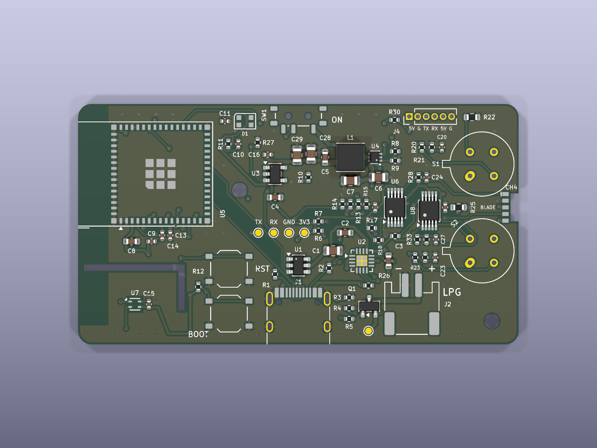

# Phone-companion board

A 66 × 36 mm, 4-layer board: bare ESP32-S3-MINI-1, two bare Figaro TGS sensors,
two ADS1115s, an SHT40, LiPo charging and a 5 V heater boost, plus a socket for
the [air blade](../air_blade/) (airflow thermistor and outside-air SHT40) and pads
for a CO module and a fan. The phone does the rest: position, display, storage
and the app. The electrical and Bluetooth spec is
[docs/phone_board.md](../../docs/phone_board.md). What the board measures and
why, with plots: [docs/board.md](../../docs/board.md).



Next to the first phone-companion board, with what is new boxed:


**Status: made and working.** JLCPCB made and assembled the boards, and they
passed a bench test on 2026-10-22. Three things to know when you first power one:

- **The boards arrive with blank flash.** Nothing runs until you flash the
  firmware.
- **The power switch (SW1) must be ON, even on USB.** It gates the 3.3 V
  regulator, so with it off the ESP32 has no power and the USB port does not
  appear.
- **The first flash needs the BOOT and RESET buttons.** Hold BOOT, press and
  release RESET, then let go of BOOT, and do a full upload (see
  [Firmware](#firmware)).

The board **fits the printed case** ([hardware/enclosure](../enclosure/),
`case.scad`): the mounting holes, sensor cans, USB-C, power switch, LED, BOOT
button and the SHT40 tongue are where the first board had them. The RST button
sits right above BOOT, so use the current front shell, `stl/front.stl`: it has
RST's pen hole in the right place and a slot for the air blade between the
sensor caps. The back shell is `stl/back.stl` and the car mount
`stl/car_adapter.stl`.

The board adds what the first survey analysis ([docs/REPORT.md](../../docs/REPORT.md))
showed was missing:

- **Airflow.** Air moving over the gas sensors cools their heaters and moves
  their readings as much as a small gas plume. The first board could not
  measure it.
- **Outside air.** The on-board SHT40 reads the air *inside the case*: on every
  drive it read 0.6–0.9 °C warmer at walking pace than at motorway speed, and
  28–32 °C during an indoor stop, because the heaters warm the case and airflow
  cools it. The detector needs the temperature and humidity of the air the
  sensors are sampling. The air blade carries a second SHT40 out in the air
  beside the sensor caps.
- **Exhaust versus gas.** Exhaust contains CO; mains gas does not.

## The air blade cannot be fitted yet

**Do not order the current air blade** ([hardware/air_blade](../air_blade/)).
J3, the board's socket for it, sits in a 3.8 mm gap between the two sensor cans,
which are 13 mm tall, and its pads stop 0.3 mm short of the blade's notch. There
is no realistic way to get a soldering iron in there and join the blade to the
pads. The blade is being redesigned. Until then the board runs without it: the
firmware uses the on-board SHT40 and reports no airflow.

## Layout

The ESP32 sits at the rear with its antenna over the left edge. The two Figaro
cans are at the front edge. USB-C is on the bottom edge and the switch on the
top edge, both in the middle.

- **Front (right) end: the gas inlet.** The two cans, each with a 0.5 Ω heater
  shunt beside its heater-return pin (R22 above CH4, R25 between the cans), and
  **J3**, the air blade's socket: five pads beside a notch in the board's end,
  in the gap between the cans where the air arrives (labelled BLADE). The
  [air blade](../air_blade/) is meant to stand in the notch, soldered to J3, and
  poke out through a slot in the case face. See above for why that does not
  work with the current blade.
- **Analogue block, just inboard of the cans.** ADS1115 #1 (U6) and #2 (U8)
  side by side; the heated thermistor's feed (R28/C24) above them;
  U8's 3V3-monitor divider (R33/R34/C27) below; the gas-sensor load networks.
- **Top edge.** **J4**, six pads for the CO module and a fan (labelled
  5V G TX RX 5V G), with R30 beside it.
- **Middle.** The boost loop (hand-routed) with the VSYS bulk capacitors C28/C29
  at its input; the battery and heater-rail dividers (R13/R14, R15/R16) in one
  row next to it.
- **Rear, by the ESP32.** The filter capacitors of the battery and heater-rail
  monitors (C13, C14) right at the ESP32 pins they feed.
- **Buttons and test pads.** RST and BOOT stacked one above the other by the
  USB edge; the serial/supply test pads in one row beside them, labelled
  TX RX GND 3V3.
- **SHT40 tongue (bottom-left).** The on-board SHT40, cut free on two sides by a
  slot. It reads the case air, and is logged as the case reading when the air
  blade is fitted.

## What it adds over the first board

| | Parts | What it does |
|---|---|---|
| **J3** + edge notch | 5 pads, 1.0 mm pitch: heated thermistor, GND, 3V3, SCL, SDA | socket for the [air blade](../air_blade/): an outside-air SHT40 (0x46, or 0x45) and the heated airflow thermistor, out in the air between the sensor caps. The current blade cannot be soldered to it (see above) |
| R28 1k, C24 | | feed the blade's heated thermistor 2.7 mW (about 1 °C above the air) |
| **U6** AIN2 | | reads the heated thermistor (16-bit); AIN3 is spare |
| GPIO1 / GPIO2 | C13, C14 at the pins | read VBAT and the heater rail on the ESP32's own ADC |
| **R22, R25** | 0.5 Ω, 0603 | in each sensor's heater return, so the heater current can be measured; fit 0 Ω links to switch this off |
| **U8** | ADS1115 at 0x49, C26 | reads both heater currents and, through R33/R34/C27, the 3.3 V rail (the thermistor dividers are not ratiometric to the ADC) |
| **J4** | 6 pads, 1.27 mm pitch: +5V, GND, TX in, RX out, +5V, GND; R30 1k | a Winsen ZE15-CO / ZE07-CO module (5–12 V, so it runs from the heater rail) and an optional 5 V fan. Pin 1 doubles as the +5 V test point |
| C28, C29 | 22 µF on VSYS | more margin when the heaters start on USB power alone (the first board browned out there) |
| SW2 (RST), TP1–TP4 | | RST right above BOOT; the test pads in a row beside them |

Pin by pin, where the board differs from the first board:

| | first board | this board |
|---|---|---|
| ADS1115 #1 (0x48) AIN2 / AIN3 | VBAT / 2, +5V_HTR / 2 | heated thermistor (air blade), spare |
| I²C bus | ADS1115 0x48, SHT40 0x44 | adds ADS1115 #2 0x49 and the air blade's SHT40 0x46 (or 0x45) |
| ADS1115 #2 (0x49) | — | AIN0 CH4 heater current, AIN1 LPG heater current, AIN2 +3V3 / 2, AIN3 spare |
| ESP32 GPIO1 / GPIO2 | backup reads of the gas taps (links never fitted) | VBAT / 2, +5V_HTR / 2 |
| GPIO43 / GPIO44 | test pads | test pads, and the CO module on J4 |
| Figaro pin 4 (heater −) | GND | 0.5 Ω shunt to GND |

## Firmware

```
pio run -d firmware/phone_board -e board --target upload
```

`board` is the default build target. On a new board, put the ESP32 into its
bootloader first (hold BOOT, tap RESET, release BOOT) and do a full upload,
because the flash is blank. After that, plain uploads work.

The firmware sends the board ID `rev-e` (a fixed value in the protocol). It
reads the heated thermistor on the ADS1115, and VBAT and the heater rail on the
ESP32. When the air blade's SHT40 answers (0x45 or 0x46), it supplies the
temperature and humidity (to the phone and to the detector) and the ambient for
the airflow calculation; the on-board readings are logged as `case_temp_c` /
`case_rh_pct` on USB serial, and the Info JSON says `"t_src":2`. Without the
blade it falls back to the on-board SHT40 (`"t_src":0`). The heater currents
(`ch4_htr_ma`, `lpg_htr_ma`) and the rail (`v3v3_mv`) go to the USB serial log
only for now: they are for a bench experiment first.

**The detector's coefficients were fitted on case-air readings.** With the
air blade fitted they need refitting from new surveys before the
detector's numbers mean anything ([docs/REPORT.md](../../docs/REPORT.md),
`python tools/replay.py fit`).

## The design is generated — edit `gen/design.py`, not the KiCad files

`gen/design.py` holds every part, net, LCSC number, placement, pre-routed track
and rule, and the scripts build the KiCad project from it:

| Step | Command | Output |
|---|---|---|
| custom symbols | `python gen/build_lib.py` | `lib/phone_board.kicad_sym` |
| schematic | `python gen/build_sch.py` | `board.kicad_sch` |
| board (placed, unrouted) | `"C:\Program Files\KiCad\9.0\bin\python.exe" gen/build_pcb.py` | `board.kicad_pcb`, `.kicad_pro` |
| autoroute | `...\python.exe gen/route.py` | routed board, GND pours + stitching vias |
| tidy silkscreen labels | `...\python.exe gen/tidy_silk.py` | |
| JLC placement | `...\python.exe gen/jlc_align.py` | `gen/jlc_placement.json` |
| fab files + renders | `python gen/export.py` | `production/`, `preview/` |
| relabel silkscreen only | `...\python.exe gen/build_pcb.py --silk-only` | edits the routed board in place |

Extra helpers: `gen/courtyards.py` prints footprint courtyards for checking
placement by hand; `gen/islands.py` and `gen/anchor_fills.py` find and anchor
unconnected ground-fill islands; `gen/add_keepouts.py` adds a keepout to a
routed board without re-routing; `gen/note_plots.py` draws the plots in
docs/board.md.

The middle of the board is dense, so a number of links are hand-routed
(`PREROUTE`) rather than left to the autorouter: the SDA trunk on In2, TXD0 to
the CO pads along the top strip on In2 and down B.Cu to the TX test pad, the
heater-rail divider feed, the two monitor lines from GPIO1/GPIO2 to their
capacitors, the 3V3-divider node, the J4 +5V pair, and short ground drops for
both ADS1115s, the air blade socket, the LPG shunt and the monitor capacitors
(where the ground fill cannot reach).

The air blade socket (J3) uses a project footprint,
`lib/phone_board.pretty/BladeSocket_1x05_P1.0mm`, and the notch is `NOTCHES` in
`gen/design.py`.

`route.py` needs the `JAVA` and `FREEROUTING` environment variables set to the
Java 25 runtime and the Freerouting 2.4.1 jar.

Checks: `kicad-cli pcb drc --schematic-parity board.kicad_pcb` and
`kicad-cli sch erc board.kicad_sch`.

Last run (2026-10-10, after adding the air blade socket and notch):
`kicad-cli pcb drc --schematic-parity` reports **0 violations, 0 unconnected
items, 0 schematic/board mismatches**; `kicad-cli sch erc` reports **0 errors,
0 warnings**; `gen/jlc_align.py` has corrected the CPL against LCSC's
footprints. Freerouting doesn't route the same way twice: after a rebuild, re-run
the checks.

## Ordering from JLCPCB

1. **PCB:** upload `production/gerbers.zip`. 4 layers, 1.6 mm. Minimums:
   0.2 mm track/clearance (0.15 mm at the SOT-563), 0.3 mm vias, and 0.2 mm drill
   for the via-in-pad GND vias under the ESP32, the charger and the two
   ADS1115s.
2. **Assembly:** top side, `production/bom.csv` and `production/cpl.csv` (already
   corrected for JLC's library by `gen/jlc_align.py`; still look over the preview,
   especially the pin-1 dots). Parts that are easy to miss in the BOM: the 0.5 Ω
   0603 shunts (FRL0603FR500TS, C2934253) and the second ADS1115 (C37593).
   **Do not order the current [air blade](../air_blade/)** with it: it cannot
   be soldered to J3 (see [above](#the-air-blade-cannot-be-fitted-yet)).
3. **Solder yourself:**
   - **Figaro TGS2611-E00 (S1, CH4) and TGS2610-D00 (S2, LPG)**, from RS
     Components (134-6647 and 134-6641). Burn them in for 4–7 days.
   - If used, **the CO module and fan on J4**
     ([docs/HARDWARE.md](../../docs/HARDWARE.md) section 2). The pads are 1.27 mm
     apart: solder thin wire straight on.

## Before you power it

Check the battery polarity (J2 pin 1 = −, pin 2 = +), and on first bring-up check
+3V3 on TP4 before fitting the sensors (SW1 must be ON). +5V_HTR is on J4 pin 1;
it stays at 0 V until the firmware drives GPIO7 high.

- **When an air blade is fitted, its tip must stand in free air,** 4.5 mm out of
  the slot, touching nothing: the heated thermistor reads airflow by how fast it
  loses heat.

## Known limitations

- The battery charger draws a little from the cell even when the board is off,
  the charge current is fixed at 500 mA, and the schematic is joined up by net
  labels rather than drawn wires.
- **The air blade cannot be fitted yet** (see above), so the airflow and
  outside-air readings are untested on this board.
- Still to be measured:
  - whether the heater current changes measurably with airflow (Figaro does not
    publish the heater's temperature coefficient);
  - the VBAT reading through the 1M/1M divider on the ESP32's ADC (C13 holds the
    charge; calibrate against a meter);
  - how much the blade's thermistor self-heats and how strongly it follows
    airflow (the still-air calibration and the airflow survey measure it);
  - whether a CO module and a fan both fit in the printed case.
- The air blade is soldered in and the CO module is wired, not connectorised: fine for
  a prototype, fragile for a fleet.
