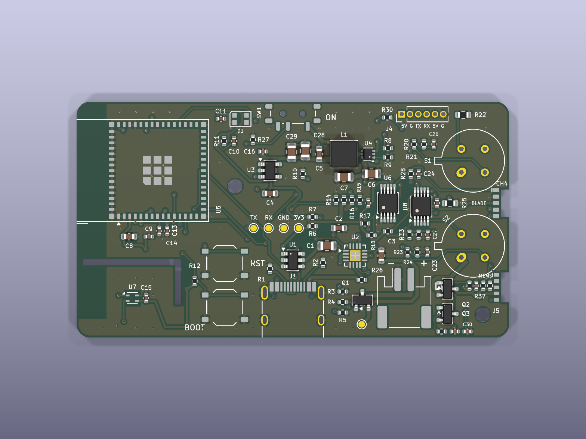

# Phone-companion board: MEMS rig

The [board](../board/) plus a socket for the [MEMS blade](../mems_blade/): a test rig
that runs two cheap MEMS gas sensors beside the two Figaro sensors on the same air, to
decide which sensor a cheaper production unit should carry. Why, what was chosen, the
power and heat budgets, the costs and the comparison plan:
[docs/mems_rig.md](../../docs/mems_rig.md). Everything else is the same as the board:
read [the board's README](../board/README.md) for the board itself.



**Status: designed, not built.** With J5 empty it works exactly like the board. It
fits the board's case with its own front shell
(`hardware/enclosure/stl/front_mems.stl`, `mems = true` in
`hardware/enclosure/case.scad`), which adds a slot for the blade. Before ordering,
note that the air blade can't be fitted to J3 yet and is being redesigned (see
[the air blade](../air_blade/)), and that the redrawn MEMS blade is untested.

## What changed from the board

| | Parts | What it does |
|---|---|---|
| **J5** + a second edge notch | 5 pads, 0.95 mm pitch, between the LPG can and H1: MEMS A, GND, 3V3, +5V_MEMS, MEMS B | socket for the MEMS blade (SY-CH4-37BPM and MiCS-5524) |
| **Q2** AO3401A, **Q3** 2N7002, R37, R38 100k, C32 1uF | high-side switch from +5V_HTR (taken at the LPG can's heater pin) | the blade's heaters, on their own enable (GPIO12, off at boot), so the firmware can stagger them after the Figaros |
| **U6 AIN3, U8 AIN3** | the two ADCs' spare inputs | MEMS A (0x48) and MEMS B (0x49), 16-bit |
| R35, R36 1M; C30, C31 100nF | pull-ups and filters on the two inputs | an empty socket reads above full scale, so the firmware can tell the blade is missing |

Pin by pin, against the board:

| | Board | MEMS rig |
|---|---|---|
| ADS1115 #1 (0x48) AIN3 | spare | MEMS A (SY-CH4-37BPM) tap |
| ADS1115 #2 (0x49) AIN3 | spare | MEMS B (MiCS-5524) tap |
| ESP32 GPIO12 | unused | MEMS heater enable (100k pull-down) |

Silkscreen: "MEMS" beside J5, and a "CH4 detector" label on the back.

## Firmware

```
pio run -d firmware/phone_board -e board_mems --target upload
```

The board's firmware plus the blade (the `board_mems` target sets `HW_MEMS`): it
checks for the blade at start-up and every sample, turns the MEMS heaters on 5 seconds
after the Figaro heaters (and off with them), waits 60 minutes before using the MEMS
readings, and counts burn-in hours. The MEMS data goes out on the Gas2 Bluetooth
characteristic and in extra USB log columns
([docs/phone_board.md](../../docs/phone_board.md)).

## The design is generated: edit `gen/design.py`, not the KiCad files

Exactly as for the board: the same scripts, the same order (`build_lib.py`,
`build_sch.py`, `build_pcb.py`, `route.py`, `tidy_silk.py`, `jlc_align.py`,
`export.py`). `gen/design.py` is the board's with the MEMS rig's parts, nets, notch
and placements added, each marked with a comment. The socket footprint is
`lib/phone_board.pretty/BladeSocket_1x05_P0.95mm` (shorter pads than the air blade's,
to clear H1).

Checks: `kicad-cli pcb drc --schematic-parity board_mems.kicad_pcb` and
`kicad-cli sch erc board_mems.kicad_sch`. Last run (2026-10-19): **0 violations,
0 unconnected items, 0 schematic/board mismatches; ERC 0 errors, 0 warnings**, and
`gen/jlc_align.py` matched every new part to LCSC's footprints. Two things were needed
on the way. The schematic moved from A2 to A1: with the extra parts it ran off the
page, and the power-flag row at the bottom landed on a +3V3 pin, merging VBUS into
+3V3 in the netlist. And J5's and C31's GND pads have filled vias in the pad, as the
copper fill cannot reach them.

## Ordering from JLCPCB

As for the board: `production/gerbers.zip`, `bom.csv`, `cpl.csv`, 4 layers, 1.6 mm,
the same minimums and via-in-pad options. New to the BOM: Q2 (AO3401A, C15127, already
on the board as Q1), Q3 (2N7002, C8545), and more of the existing resistors and
capacitors. Order the [MEMS blade](../mems_blade/) and the
[air blade](../air_blade/) with it, once the air blade's redesign is done.

Solder yourself: the two Figaro sensors, the air blade into J3, the MEMS blade into J5
(sensors facing away from the middle of the board), and if used the CO module and fan
on J4.

**Battery lead:** bring it up past the board's end at the **power-switch corner**, not
the USB-C corner as on the board: the MEMS blade stands there now.

## Known limitations

- Everything in [the board's list](../board/README.md#known-limitations).
- The MEMS blade sits above the LPG can when the case stands on its switch edge on a
  car mirror, so at stops it is in the can's warm air ([docs/mems_rig.md](../../docs/mems_rig.md#heat)).
- A fan on J4 together with the blade and a CO module is over the USB 500 mA budget:
  run a fan only with the battery fitted.
