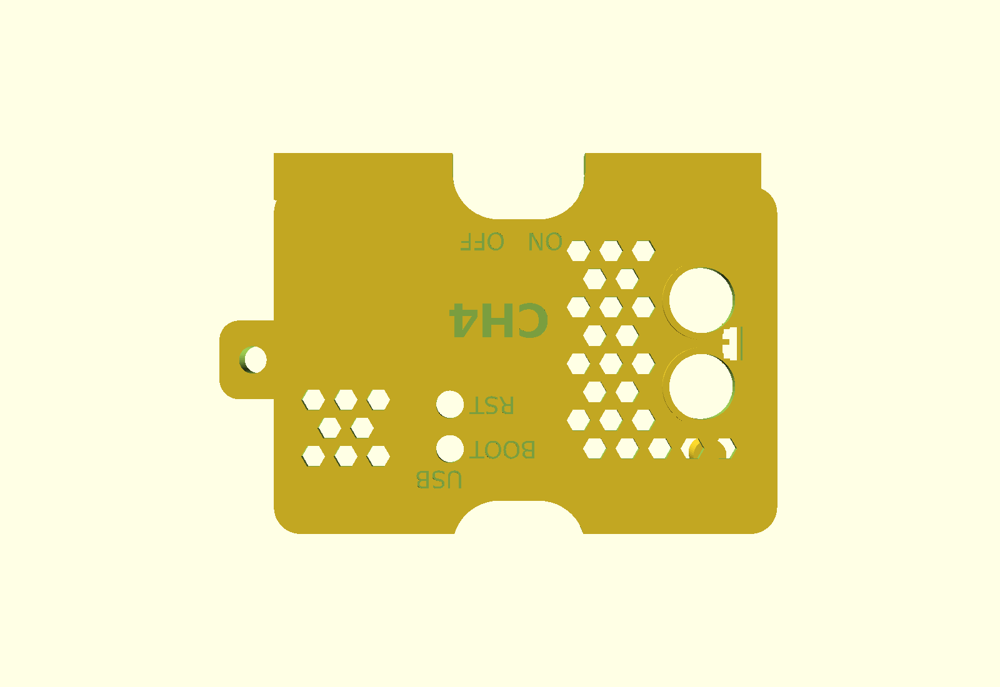
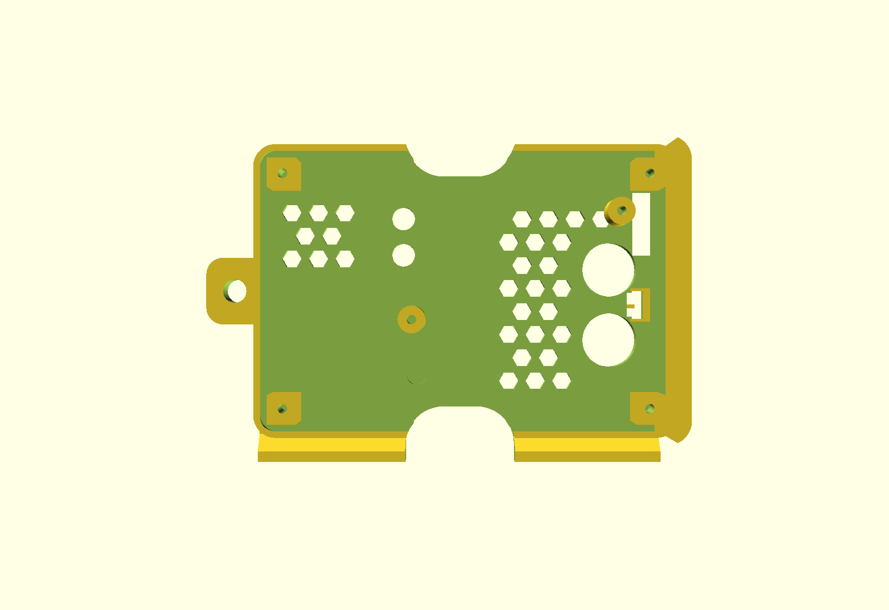
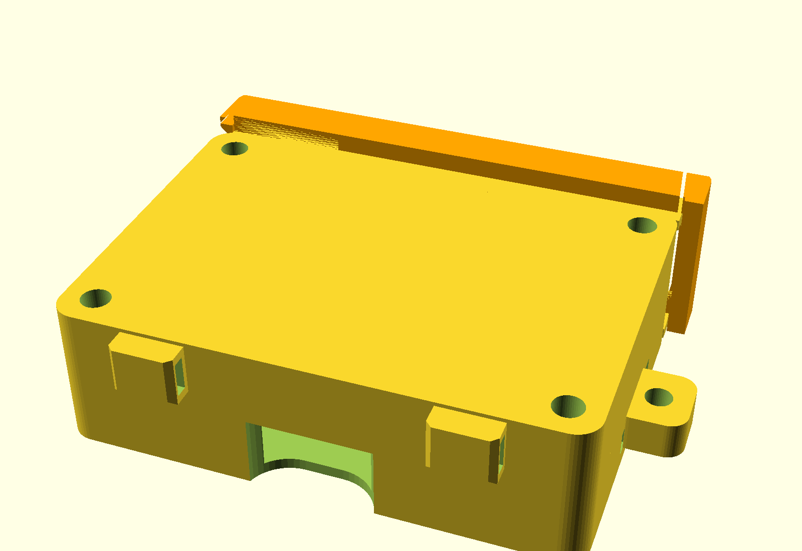
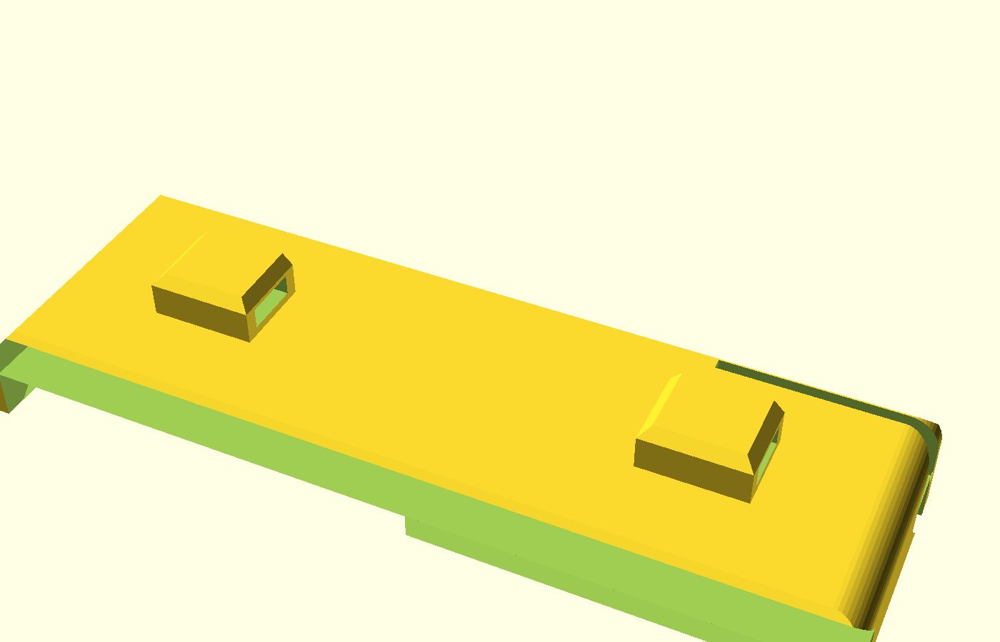
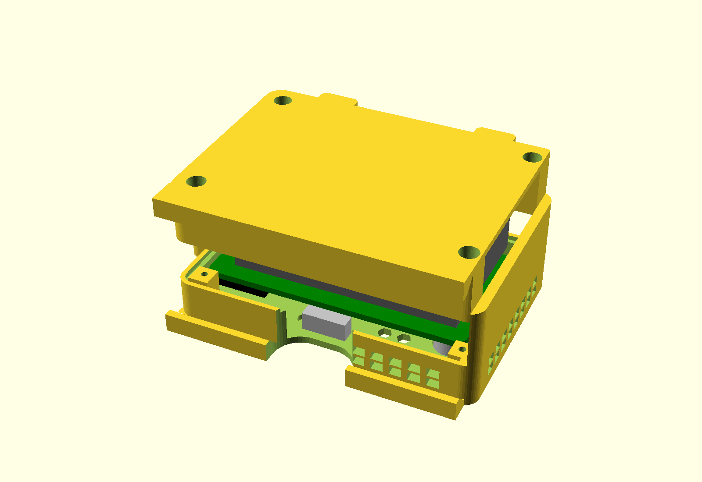

# Handheld enclosure

A two-part printed case for the [phone-companion board](../board/): a
front shell the board screws into, and a back tray that holds the battery.

There is one case, `case.scad`, sized for the 66 × 36 mm board. Export it with
`-D mems=true` to get the front shell for the [MEMS rig](#mems-rig). Older cases
are in the archive: the case for the first board in
[archive/enclosure_rev_b](../../archive/enclosure_rev_b/), and the earlier
box-and-lid cases in [archive/enclosure_boxes](../../archive/enclosure_boxes/).

The case is **75.8 × 52.4 × 25.5 mm**. The battery is an EEMB 103454RP (2000 mAh,
56 × 34.5 × 10.3 mm). The corner posts sit beside the board's long edges, and the
end walls sit close to the board: 1.5 mm away at the SHT40 end and 3.5 mm at the
sensor end, where the battery lead comes up past the board to the JST. Checked in
the model: the board touches the shell only where it rests on its two screw bosses,
and the cell clears the tray and passes the corner blocks with 1.35 mm each side.
Measure the cell when it arrives: the pocket allows 0.6 mm play around 34.5 × 56 mm
and 1 mm over 10.3 mm.

**Air blade slot.** The face has a 2.0 × 5.1 mm slot between the two sensor caps,
at the sensor end (sized for a 1.6 mm-thick blade; `blade_t` in the model). The
[air blade](../air_blade/) stands in a notch in the board's end and pokes 4.5 mm out
through it, so its sensors sit in the outside air level with the sensor caps.
Inside, a small guide (two 0.8 mm walls and thin end walls, 4 mm deep) continues
the slot toward the board, so the blade rests in it over 5.8 mm of its length and a
knock on the tip does not land on the solder joint. Checked in the model
(`blade_mock()`): the blade clears the guide, face, collars and back tray by 0.2 mm,
and the guide clears the sensor cans. **This slot is provisional:** it is drawn for
the current blade, which is being redesigned, so it may change.

**No louvres on the USB side.** The case stands on its switch edge on the
[car mount](#car-mount), so the USB-side wall faces the sky; it has no louvres. The
on-board SHT40 keeps the face grille over it and the slots in the lanyard-end wall
beside it.



## MEMS rig

The [MEMS rig](../board_mems/) (not made yet) is the board plus the
[MEMS blade](../mems_blade/), so it uses the same back tray and car adapter and its
own front shell, `stl/front_mems.stl` (`-D mems=true`). That is the normal front
shell with a second slot, 3.55 × 11.7 mm, beside the LPG cap, for the MEMS blade and
its two sensors (the slot stops just short of the cap hole). Checked in the model
(`mems_blade_mock()`): the blade and its parts clear the shell, the H1 boss, the end
wall and the tray. On the MEMS rig the battery lead must come up past the board's
end at the power-switch corner: the blade stands in the other corner.



## Car mount

To survey from a car, the case slides onto a small adapter that is zip-tied to a
wing mirror. There are three parts to print: the front shell
(`stl/front.stl`), the battery side (`stl/back.stl`) and the car
adapter (`stl/car_adapter.stl`). The case stands on its switch edge on the adapter,
so the sensor face looks sideways, the narrow edge faces the wind, and the USB-C edge
stays free for a charging cable.



- **Both halves of the case have a flange along the switch edge**, flush with their
  outer faces: the battery side's along its back, the front shell's along its face.
  Each sticks out 5 mm and thickens toward its outer edge; both end level with the
  battery side, and the adapter ends flush with the case. Put together, the two make
  a C-shaped channel along that edge, the whole depth of the case. (The battery side's
  switch-side wall loses its two zip-tie eyelets to the flange; the USB-C side keeps
  its eyelets.) The front shell's flange is cut away at the switch's thumb scallop.
  For a plain case without the flanges, export with `-D mount_rail=false`.
- **The car adapter** runs the length of the case (about 84 × 14 × 26 mm with its
  eyelets). It is a T: a plate against the mirror and a head that slides
  into the C. It holds the case by both flanges, about 19 mm apart, so twisting the
  case can't lever it off, and pulling it straight off would mean prising the two
  halves of the case apart. It is one plain profile end to end, so it covers the switch
  and the switch-side vents: **switch the case on before sliding it on.**
- **To mount:** hold the case on its switch edge and slide it onto the adapter
  lanyard end first, until the case's lanyard end meets the adapter's stop. A springy
  arm under the battery side's flange rides along under it and, as the case goes home,
  springs up past the end of the flange and catches on it. That's the latch.
- **To take it off:** press the end of the arm (the thin strip along the bottom of
  the adapter, at the sensor end) away from the case, and slide the case off.
- **Fixing the adapter to the mirror:** two zip-tie eyelets on its back, the same as
  the battery side's and at the same places along the case, centred on the plate.
  Put a 5 mm zip tie through each and round the mirror housing. A strip of rubber or foam tape behind the adapter stops it sliding on the
  mirror and takes up any curve. UV-resistant ties (the black outdoor kind) last
  longer in the sun.
- **Fit:** 0.15 mm clearance all round (`car_fit`). If it prints too tight or too
  loose, change `car_fit` and reprint only the adapter (the flanges don't depend on it).
- **Print:** the adapter prints case side down, eyelets up, as the STL is laid out;
  the flanges print flat as the first layers of each half. No supports anywhere.
- **History:** this replaces a rail-based design (2026-10-12) that printed and slid
  well but could be twisted off and wobbled.
- **Not yet tested on a car.** Check that the arm has clicked in before driving off,
  and try it at low speed first.
- **3D view:** open `assembly.html` in a browser to turn the whole thing round, take
  it apart and watch the case slide onto the adapter.



## The design

The board screws into a **front shell** with the sensors through its face, and a
**back tray** carries the battery in its own pocket and traps it when screwed on.



- **Front shell.** Sensor collars and cap holes in the face, hex grille around them
  and at the SHT40 end, RST/BOOT pen holes (RST sits right above BOOT), LED window,
  engraved lettering, and the air blade slot. Inside, two 7 mm bosses at the
  board's H1 and H2 holes: the board goes in component side first and two
  M2 × 5 screws through the board's back pull it onto them. USB-C and the switch
  sit in notches open to the shell's back edge, so both are reachable with the tray
  off; the tray's rim closes them. Louvres at component level on two sides of the
  sensor end (none on the USB side, see above). Four corner posts with pilot holes
  take the tray screws.
- **Back tray.** A closed compartment for the cell: floor, side fences, an end
  fence at the SHT40 end and a 1.2 mm divider plate over the top that keeps the
  cell separate from the board. The compartment is open at the sensor end, a
  full-width slot the cell slides into like a drawer; the divider stops 8 mm
  short of that end so the lead can come up through the gap to the board's
  JST. The front shell's sensor-end wall carries a skirt that reaches down over
  the open end, so with the tray screwed on the slot is closed and the cell is
  captive. Four counterbored corner posts, lip into the shell's rebate on the
  other three sides, zip-tie eyelets on the USB-C wall (the tie passes through them along the
  wall; 1.4 mm bridge over the tie) and the car-mount flange along the switch wall (see [Car mount](#car-mount)). No vents in the
  battery compartment.
- **Orientation**: the board lies component side down in the shell. It goes in
  as if turned over about its long axis, so the sensor end stays at the
  lanyard-free end, the switch is on one long edge and USB-C on the other. Seen
  from the front, the two collars are on the left with CH4 the lower one, the
  switch scallop on the bottom edge, and the SHT40 grille top right.
- **Access with the tray on**: matching 20 mm wide, 5 mm deep scallops cut
  through the face and wall at both the switch and the USB-C socket, on top of
  the side notches, so a thumb reaches the lever and a plug goes in from the
  front edge.
- **Screws**: 4 × M2 × 8 for the tray, 2 × M2 × 5 for the board. The tray's
  counterbores leave 2.5 mm of plastic under each head, so an M2 × 8 bites well
  into the shell's posts. A PH0 or PH00 driver reaches the head down the 4.6 mm
  bore.
- **Corner posts**: every corner post is embedded in a solid block joined to the
  adjacent walls, in both parts. (An early print's two tray posts at the open end
  stood alone on the floor and snapped off.) The lead passes between the two
  blocks at the open end. Face lettering: CH4, RST, BOOT, USB by the port scallop,
  ON / OFF either side of the switch scallop (ON is lever toward the sensor end).
- **Print**: front face down (collars and lettering on the plate), tray outer
  face down. No supports: the divider bridges between the side fences, which
  PETG on the A1 handles. The car-mount flanges print flat as the first layers of
  each half, so they need no supports either; the adapter prints case side down.
- **Assembly**: fit the sensors' end of the board under the collars and screw
  the board to the bosses. Slide the cell into the tray's open end, lead first
  is easiest, until it meets the end fence. Bring the lead up through the gap
  at the end of the divider, past the end of the board, and plug it into the
  JST. Screw the tray on: the shell's skirt now covers the open end.
- `-D 'part="section"'` cuts the assembled case in half lengthways for a
  clearance check.

## Files

| File | What |
|---|---|
| `case.scad` | the model, parametric: edit this, not the STLs |
| `stl/front.stl` | front shell |
| `stl/back.stl` | back tray, with the car-mount flange on the switch side |
| `stl/car_adapter.stl` | car adapter: zip-ties to a wing mirror, the case's flanges slide onto it |
| `stl/front_mems.stl` | front shell for the MEMS rig: the normal one plus the MEMS blade slot (it uses the same back tray and car adapter) |
| `build/assembly.png` | the case taken apart (render above) |
| `build/face.png` | the front shell's outside face |
| `build/face_mems.png` | the MEMS rig's front shell, seen from inside (so the lettering reads backwards) |
| `build/car_mounted.png`, `build/car_adapter.png` | car mount renders |
| `assembly.html` | interactive 3D view of all the parts: explode it, slide the case onto the car adapter, cut it open. Open it in a browser (needs internet for the 3D library) |
| `make_assembly_html.py`, `assembly_template.html` | rebuild `assembly.html` from the model after a change |

Regenerate after editing (OpenSCAD 2021.01+):

```
openscad -o stl/front.stl       -D 'part="front"' case.scad
openscad -o stl/back.stl        -D 'part="back"'  case.scad
openscad -o stl/car_adapter.stl -D 'part="car"'   case.scad
openscad -o stl/front_mems.stl  -D 'part="front"' -D 'mems=true' case.scad
openscad -o build/assembly.png --imgsize=1600,1100 -D 'part="assembly"' case.scad
python make_assembly_html.py      # rebuilds assembly.html (needs numpy)
```

`part="assembly"` also draws a mock board, sensors and cell, which is the
quickest way to check a change hasn't broken clearances.

## Printing

- **Material: PETG or ASA.** The heaters put ~0.6 W inside a small box and the
  case sits in sunlight on surveys; PLA creeps and can sag. PETG is the easy pick.
- **0.2 mm layers, 3 walls, 20 % infill.** No supports, no brim needed.
- **Orientation:** front shell face down, back tray outer face down.

## Hardware you need

| Qty | Item |
|---|---|
| 4 | M2 × 8 mm self-tapping screws (tray into the shell's corner posts) |
| 2 | M2 × 5 mm self-tapping screws (board to the bosses at H1 and H2) |
| 2 | for the car mount: long 5 mm zip ties, UV-resistant (black outdoor ones from any hardware shop or Amazon); optional strip of rubber or foam tape for behind the adapter |
| 1 | 1S LiPo, JST-PH, protected: the compartment is sized for the EEMB 103454RP 2000 mAh cell, 56 × 34.5 × 10.3 mm (see the [board README](../board/README.md) for polarity) |

## Known compromises

- **Not weatherproof.** The sensors need open air, so the shell is vented.
- **The sensor cans get hot** (~280 mW each). They protrude by design; don't grip
  them, and give the device a minute of settling after handling before trusting
  a reading.
- **SHT40 accuracy:** the tongue on the board and the grille at that end help, but
  temperature inside any case reads slightly high. Compare against a reference
  thermometer before trusting absolute temperature.

## If you change the board

`case.scad` carries the board dimensions and part positions at the top
(all in KiCad board coordinates, origin at the board's top-left corner). Update
them there and re-export. Set `board_t = 1.0` if you order 1 mm boards.
