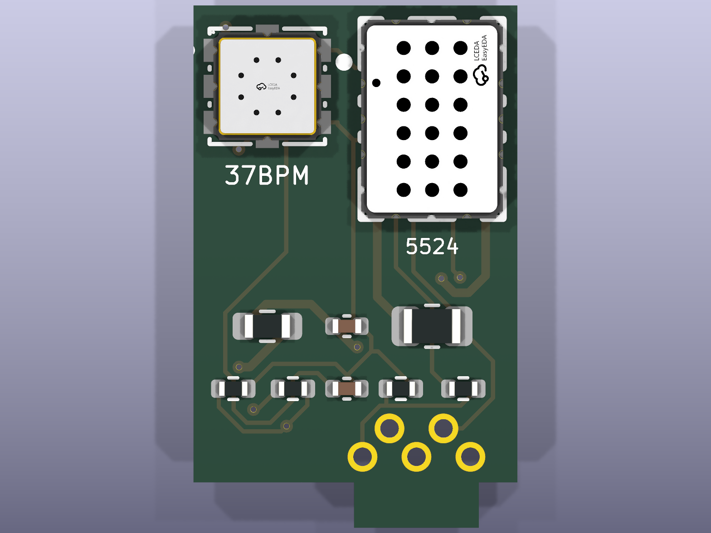

# MEMS blade (for the MEMS rig)

A small plug-in board, 11.4 x 18.4 mm and 1.6 mm thick, that carries two MEMS gas
sensors for the [MEMS rig](../board_mems/)'s sensor comparison
([docs/mems_rig.md](../../docs/mems_rig.md)). It stands upright in a notch in the rig's
sensor end, beside the LPG sensor, and its tip stands 8 mm out of a slot in the case
face, so both sensors breathe the same air as the Figaro sensors and the air blade.

**Status: designed, not built. Redrawn on 2026-10-22 and not yet tried against a
real board.** The first drawing was a mirror image of what J5 needs (the same mistake
as the first batch of air blades), so its pads would have missed J5. It has been
redrawn with the parts the right way round (see "Why it was redrawn" below). Check the
pin order against J5 once more before ordering.

## What is on it

| Ref | Part | LCSC | What it does |
|---|---|---|---|
| U1 | Saiya **SY-CH4-37BPM**, 3.8 x 3.8 mm | C22363924 | methane sensor (sensor A, `mems_a`) |
| R1 | 82 ohm, 0603 | C23255 | U1's heater resistor: 5 V in, about 3.6 V and 60 mW at the heater |
| R3, R4 | 10 k + 10 k, 0402 | C25744 | U1's load (20 k), read at the middle |
| U2 | SGX **MiCS-5524**, 5 x 7 mm | C3659348 | CO, hydrogen and other reducing gases, weak on methane (sensor B, `mems_b`) |
| R2 | 82 ohm, 0805 | C17841 | U2's heater resistor: about 2.4 V and 76 mW at the heater; it drops 84 mW itself, hence 0805 |
| R5, R6 | 100 k + 100 k, 0402 | C25741 | U2's load (200 k), read at the middle |
| C1 | 1 uF | C52923 | heater feed decoupling |
| C2 | 100 nF | C1525 | 3.3 V decoupling |
| J1 | 5 plated foot holes for wire legs | (not assembled) | wire legs to the rig's J5 |

Foot holes, from the one nearest the LPG can: 1 sensor A output, 2 GND, 3 3.3 V,
4 switched 5 V for the heaters, 5 sensor B output.

The parts face the case's end wall, not the middle of the board: facing the middle,
the sensors would hit the case's H1 screw boss on the way into the shell. The foot
pads are on the back. The heater resistors and the load resistors sit low on the
blade, inside the case, so their warmth stays away from the sensors.

## Ordering from JLCPCB

The blade is below JLC's minimum size for assembly, so order the ready-made panel in
**`production/panel/`**: 6 blades in a 52 x 53 mm frame, with tooling holes and
fiducials.

1. **PCB:** upload `production/panel/gerbers.zip`. 2 layers, **1.6 mm**. Leave
   Delivery Format at "Single PCB" (the file already is the panel), so the quantity
   counts panels.
2. **Assembly:** top side only, `production/panel/bom.csv` and
   `production/panel/cpl.csv`. Assemble **2 panels** (JLC's minimum) = 12 blades.
   Positions are already matched to LCSC's footprints (`gen/jlc_align.py`). Check the
   preview, especially both sensors' orientation.
3. **Reserve the sensors first.** LCSC had only 71 SY-CH4-37BPM in stock on
   19 October 2026. Add them to your JLC parts library before ordering.
4. **Breaking out:** each blade hangs on one small tab of drilled holes on each long
   side, about level with the case face. Bend the blade out, then **file both nubs
   flush**, or they catch in the case slot.

`production/gerbers.zip`, `bom.csv` and `cpl.csv` (one blade) are kept for reference.

## Fitting it to the MEMS rig

You need five pieces of **0.5 mm (24 AWG) solid tinned copper wire**, about 6 mm long,
flux, a fine tip and quick-set epoxy, as for the [air blade](../air_blade/README.md).

1. **Legs into the blade.** Push a wire through each foot hole from the parts side so
   about 3 mm sticks out of the back (the side with the "MEMS BLADE A" label). Solder
   each one, then trim the parts side flush.
2. **Bend the legs down** at a slant towards the tab, so each end will rest on its J5
   pad about 0.8 mm out from the blade's back.
3. **Tin the rig's J5 pads** (the five pads beside the second notch, labelled MEMS).
4. **Stand the blade in the notch** with the **sensors facing away from the middle of
   the board** (the legs towards J5) and the shoulders flat on the board. Seen from the
   end wall, the methane sensor (37BPM) is on the left and the MiCS-5524 on the right,
   over the LPG can's side. Hole 1 lands on J5 pad 1, the one nearest the LPG can.
5. **Solder each leg to its pad,** check no two pads are joined, and check each
   connection with a meter.
6. **Epoxy** a small bead along both shoulders and into the notch around the tab. That,
   not the solder, holds the blade up.
7. Fit the board into the MEMS rig's front shell
   (`hardware/enclosure/stl/front_mems.stl`) straight down: the blade goes out through
   the slot beside the LPG cap.
8. Bring the battery lead up past the **other** end corner (the power-switch side) and
   over the board to the battery plug: the blade now stands where the lead goes on the
   plain board.

### Why it was redrawn

Fixed on 2026-10-22, before any were made. The first drawing of this blade was a
mirror image, the same mistake as the first batch of air blades (soldered in, one of
those stopped the board's I2C bus). Its flat foot pads would also have missed J5 by
about 0.3 mm each way. It now has the parts the right way round and wire-leg holes
instead of flat pads.

## Before you survey

- **Burn in 48 hours** with the board running (the firmware counts the hours). The
  Saiya datasheet asks for at least 4 hours powered after soldering.
- **Warm up 60 minutes** after every power-up. The firmware ignores the MEMS readings
  until then.

## The design is generated: edit `gen/design.py`, not the KiCad files

As for the air blade. `gen/design.py` holds the parts, nets, LCSC numbers, outline
and placement; the scripts build the KiCad project from it.

| Step | Command (from this folder) |
|---|---|
| schematic | `python gen/build_sch.py` |
| board (placed) | `"C:\Program Files\KiCad\9.0\bin\python.exe" gen/build_pcb.py` |
| autoroute | `...\python.exe gen/route.py` (needs `JAVA` and `FREEROUTING`, as for the MEMS rig board) |
| JLC placement | `...\python.exe gen/jlc_align.py` (needs `EASYEDA2KICAD`) |
| fab files + renders | `python gen/export.py` |
| 6-up panel | `...\python.exe gen/build_panel.py` (needs `kikit` in KiCad's python) |

The two sensor footprints, symbols and 3D models came from LCSC through
easyeda2kicad (`lib/`). Their pins were checked against the datasheets: on the
37BPM, pads 1 and 5 are the heater and 3 and 7 the sensing electrodes; on the
MiCS-5524, C and F are the heater and D and G the sensing electrodes.

Checks: `kicad-cli pcb drc --schematic-parity mems_blade.kicad_pcb` and
`kicad-cli sch erc mems_blade.kicad_sch`. Last run (2026-10-22): **0 violations,
0 unconnected pads, 0 parity errors; ERC 0 errors, 0 warnings.**

## Not known yet

- Whether the redrawn blade lines up with J5 on a real board.
- Whether the load resistors (20 k, 200 k) put each sensor's clean-air output in a
  good range. Check once a blade runs: aim for roughly 100 to 800 mV at the tap.
- The MiCS-5524's response time, temperature and humidity behaviour, and burn-in.
- Whether wire legs plus epoxy hold a blade this size.
